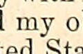

# Human-reported reading obstacle: ra}' → my

The human's HR-004 submission identified `ra}'` as an incomprehensible word that hurt reading, despite the passage's general subject remaining clear. The original print reads **my**:

> …the whole people and my obligations to the Constitution…

This is a source-supported **proposal**, not an accepted correction. Original OCR, accepted ledgers and the exact human submission are unchanged. The human reported the reading obstacle; the printed transcription above is a separate AI visual observation, not a human grade.

## Evidence and sequence

1. `case-initial.json` freezes the original human answer, packet/submission/hash reference, full raw paragraph and exact Unicode span303:307. Source: `congressionalglo7392unit:1009:par_001009_000042`, printed page1857, raw SHA-256 `5f649d554b54ff7d78ebe97147cfb869744cf6ab46d65632fbd16d5b98bc0207`.
2. The existing verified same-page cache shows paragraph37, bounds1924,2373–2939,2943. It cannot establish the word in paragraph42 at2436,3658–2556,3736. The initial record therefore correctly leaves the printed reading unresolved; it has not been overwritten after getting new evidence.
3. Under existing bounded S0 retrieval authorization, the existing scan CLI prepared exact span303:307 with expected original text and24pixels padding, then fetched one120×78region from official IA IIIF. Exactly2external HTTP requests,4,241total bytes (3,242image bytes),2.015summed request-seconds; local source parsing/verification and human/agent time excluded. No retries, full-page download, model call or model load. The stored target, original hOCR/page-map hashes, native3158×4290frame, JP2 leaf identity, request receipts, image dimensions and cache integrity were verified.
4. Root inspected `word/crop-01.jpg` directly. The letters **my** are visible with neighboring print; this is not a guess from grammar. `source-assessment.json` pins the crop hash `ea58484a5c3866075a46087b01fcbe2903158cc0539f82464ee0403c7c49177e` and records the narrow visual scope. The whole paragraph was not visually transcribed or certified.
5. `proposal.json` holds a typed existing `ReadingPatch`, read-only replay and reversible raw/clean span mappings. `preview.txt` changes only the four-character OCR span to two-character `my`; exact checks prove all text before/after is unchanged. Other OCR damage remains intentionally present. The corpus was not patched.

## Validation and human-facing result

`read_bundle` verifies the complete source-image cache offline. Existing scan geometry/fetch/CLI tests:40passed (`scan-tests.log`). Browser proof (`browser-proof.json`) confirms the new catalog entry displays paragraph42, selected OCR `ra}'`, the loaded120×78image and no alerts. The source-image view makes no model calls and requires no new human submission. Choose **Human-reported reading obstacle — part2, printed page1857, exact damaged word** in [the local desk](http://10.0.0.56:8501/?view=source-images).

The artifact manifest hashes the exact package. No production code changed; this unit adds bounded evidence and one existing catalog entry. The earlier corpus/model experiments, human packets and application receipts remain immutable.

## Research implication and limits

This is one human-reported comprehension failure resolved against a tiny source crop. It shows why a broad subject being understandable is insufficient evidence of comfortable reading. It does not estimate frequency, full-document readability, TTS quality, a provider's accuracy or the benefit/cost of corpus-wide cleanup. It creates no automatic correction policy and does not close P0. Human assessment, source fidelity and software replay are separate evidence dimensions.
